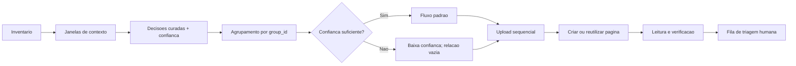

# Pipeline auditavel de triagem de materiais para o Notion

Um showcase de engenharia de dados e automacao **human-in-the-loop**: transforma
um acervo desestruturado em lotes rastreaveis, envia os materiais a uma fila de
triagem no Notion e verifica cada gravacao antes de considera-la concluida.

O foco nao e o acervo que originou o estudo de caso. Imagens, PDFs, planilhas,
documentos de revisao e conversas exportadas **nao fazem parte deste repositorio**.
O que fica publico e a metodologia: contratos, codigo configuravel, fixtures
sinteticas, testes e decisoes de confiabilidade.

## Por que este projeto existe

Automacoes de catalogacao costumam falhar de duas formas: exigem certeza antes
de registrar qualquer item ou transformam inferencias frageis em metadados
definitivos. Este projeto usa uma terceira via:

- registra o material na fila certa mesmo quando a evidencia e incompleta;
- torna a incerteza visivel no titulo, no corpo e no controle local;
- deixa relacoes semanticas vazias quando nao ha correspondencia inequivoca;
- preserva uma chave idempotente e o estado de cada tentativa;
- le novamente a pagina criada ou reutilizada antes de marcar sucesso;
- reserva aceitar, corrigir e rejeitar para a equipe de triagem.

## A metodologia em uma figura



## Quickstart

Requisito: Node.js 22 ou superior. Nao ha dependencias de producao.

```bash
npm test
npm run demo
```

A demonstracao executa enriquecimento, agrupamento e sincronizacao em dry-run.
Os artefatos locais ficam em `.local/demo/`, que e ignorado pelo Git.

Para executar cada etapa separadamente:

```bash
node src/cli.mjs enrich \
  --inventory examples/inventory.synthetic.csv \
  --messages examples/messages.synthetic.json \
  --decisions examples/decisions.synthetic.json \
  --out .local/enriched.json

node src/cli.mjs prepare \
  --enriched .local/enriched.json \
  --attachments examples/fixtures \
  --groups .local/groups.json \
  --tracking .local/tracking.csv

node src/cli.mjs sync \
  --groups .local/groups.json \
  --tracking .local/tracking.csv \
  --summary .local/summary.json
```

Sem `--apply`, a ultima etapa nao chama a API.

## Uso com um workspace de teste

1. Copie `config.example.json` e ajuste somente os nomes das propriedades.
2. Configure os segredos fora do repositorio, usando `.env` apenas como apoio
   local e nunca fazendo commit dele.
3. Compartilhe as data sources com a integracao do Notion.
4. Rode o dry-run e inspecione `groups.json` e `tracking.csv`.
5. Em uma data source descartavel, execute `sync` com `--apply`.

```bash
export NOTION_API_KEY="..."
export NOTION_DATA_SOURCE_ID="..."
export NOTION_DISCIPLINES_DATA_SOURCE_ID="..."

node src/cli.mjs sync \
  --groups .local/groups.json \
  --tracking .local/tracking.csv \
  --config config.local.json \
  --summary .local/apply-summary.json \
  --apply
```

O exemplo usa a versao `2026-03-11` da API, data sources como pais de paginas,
File Uploads de uma parte e backoff que respeita `Retry-After`. Consulte a
[documentacao de data sources](https://developers.notion.com/reference/data-source),
o [guia de arquivos](https://developers.notion.com/guides/data-apis/working-with-files-and-media)
e os [limites de requisicao](https://developers.notion.com/reference/request-limits)
antes de uma integracao real.

## Estrutura

```text
src/
  cli.mjs              comandos e demo end-to-end
  pipeline.mjs         contexto, enriquecimento e lotes
  notion-client.mjs    API, paginacao, uploads e backoff
  sync.mjs             idempotencia, retomada e verificacao
  lib/                  CSV, JSON, argumentos e escrita atomica
examples/               apenas dados sinteticos
test/                   testes sem rede
docs/                   metodologia e decisoes de projeto
.github/                CI e templates de colaboracao
```

## O que o codigo demonstra

- **Proveniencia:** toda decisao possui evidencia textual curta e contagem de
  ocorrencias de contexto.
- **Agrupamento:** `group_id` e a unidade de idempotencia, nao o nome do arquivo.
- **Ordem:** anexos sao ordenados por `source_order` antes do upload.
- **Retomada:** cada ID de upload e salvo imediatamente em CSV por escrita atomica.
- **Incerteza explicita:** baixa confianca recebe marcador e nunca ganha relacao
  de disciplina por aproximacao.
- **Verificacao:** titulo, arquivos, ordem, data, tipo e relacao sao comparados
  com o estado esperado.
- **Resiliencia:** 429 e erros transitorios usam backoff exponencial com jitter;
  tres falhas consecutivas da mesma causa abrem o circuit breaker do lote.

## Estudo de caso anonimizado

A metodologia foi consolidada apos uma execucao real com 223 itens organizados
em 59 grupos. Quarenta grupos seguiram o fluxo padrao e 19 foram registrados com
baixa confianca para revisao humana. Cinquenta e seis paginas foram criadas,
tres paginas preexistentes foram revalidadas e a rodada terminou sem falhas
finais. Sao publicados apenas esses totais agregados; nenhum anexo, conversa,
URL de pagina ou identificador real foi preservado aqui.

Veja [o estudo de caso](docs/case-study.md), [a arquitetura](docs/architecture.md)
e [a metodologia](docs/methodology.md).

## Limites

- A decisao semantica do exemplo e curada; o projeto nao afirma que heuristicas
  ou um modelo substituem revisao de contexto.
- O upload implementado e `single_part`; arquivos acima de 20 MiB exigem o
  fluxo multipart documentado pelo Notion.
- Um dry-run prova contratos locais, nao permissoes ou schema remoto.
- O projeto nao aciona botoes nem automatiza a decisao final da triagem.

## Licenca

MIT. Ao reutilizar, mantenha dados reais fora do repositorio e adapte o modelo
de ameacas ao seu contexto institucional.
