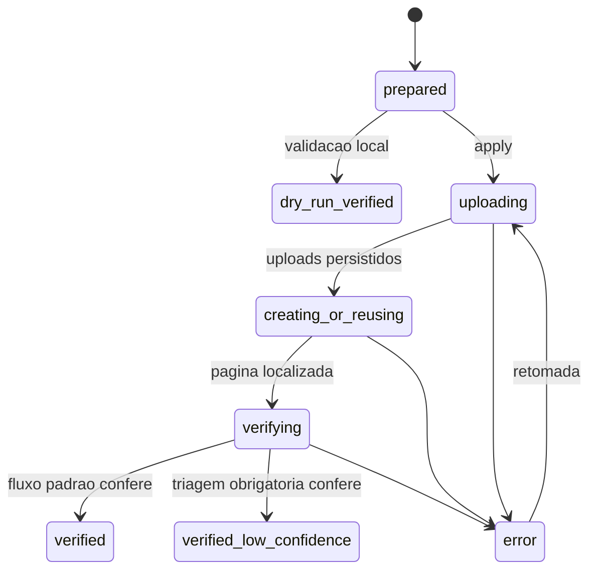

# Arquitetura

## Componentes e fronteiras

O pipeline separa quatro responsabilidades para que uma falha de classificacao
nao se confunda com uma falha de transporte.

| Camada | Entrada | Saida | Responsabilidade |
|---|---|---|---|
| Evidencia | inventario e mensagens estruturadas | registros enriquecidos | localizar contexto sem afirmar significado |
| Decisao | registros e decisoes curadas | metadados com confianca | declarar interpretacao e justificativa |
| Preparacao | registros enriquecidos | grupos + controle CSV | validar arquivos, agrupar e ordenar |
| Sincronizacao | grupos + controle | paginas verificadas | upload, idempotencia, retomada e comparacao |

## Estado da sincronizacao

O CSV local e um journal operacional, nao um espelho completo do Notion. Ele
registra o minimo necessario para retomar com seguranca: chave, pagina, uploads,
tentativas, erro e horario.

## Chaves e idempotencia

`group_id` e estavel e aparece no titulo publico. Antes de criar uma pagina, a
rotina consulta o titulo exato. Zero resultados permite criacao; um resultado
e reutilizado e verificado; mais de um resultado e um erro que exige decisao
humana. Isso evita escolher silenciosamente entre duplicatas.

## Dependencias externas

O runtime usa apenas APIs nativas do Node.js 22. A unica dependencia remota em
execucao `--apply` e `https://api.notion.com`. Testes e demo nao usam rede.
